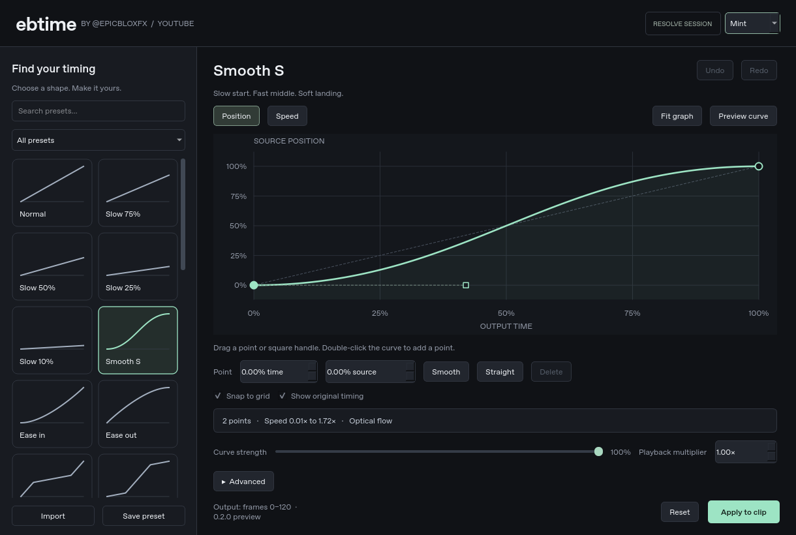

# ebtime

**Time curves for DaVinci Resolve. By @epicbloxfx on YouTube.**

[Download the Windows preview package](https://github.com/progamer3boi/ebtime/raw/refs/heads/main/downloads/ebtime-0.2.0-preview.zip)



Pick a graph, drag it into shape, and apply the timing to your Fusion effect. Version **0.2.0 preview** replaces the old text graph with a drawn, interactive graph and a new Qt interface.

## Install on Windows

1. Download the ZIP above. Right-click it → **Extract All**. Close Resolve.
2. Install **Python 3.11 or 3.12 from [python.org](https://www.python.org/downloads/windows/)** if you do not already have a compatible Python. Include the Python launcher and **Add Python to PATH**. Avoid the Microsoft Store stub.
3. Double-click **Install Windows.cmd** in the extracted folder. The first installation downloads PySide6 into an isolated ebtime runtime; allow a few minutes and keep the window open. It does not change your other Python environments.
4. Restart Resolve. Find **ebtime** under Edit → Effects → Fusion Effects, or insert the macro in Fusion.
5. With an ebtime effect selected on the Fusion page, click **Open Editor**. Alternatively run **Fusion → Scripts → Comp → ebtime Editor** and choose the **Python** entry if both Python and Lua entries appear.

Resolve must have working **internal Python scripting** configured. This release does not require an external scripting connection: Resolve launches a separate Qt editor and applies the returned curve in its own script context. Opening the editor from an Edit-page effect button depends on Resolve version/edition; use the Fusion page if it does not launch there. The actual Resolve integration has not yet been verified in Resolve on Windows.

To explore the interface without Resolve, double-click **Open Curve Designer.cmd** after installation. This mode imports, edits and exports curve files; it cannot apply to footage.

For a nonstandard Fusion folder: `python install.py --fusion-root "your/Fusion/folder"`.

## Your first retime

1. Apply ebtime directly to a **video or compound clip**. In Fusion, connect it between MediaIn and MediaOut.
2. Open the editor and choose **Slow 50%**, **Smooth S**, **Impact**, **Reverse**, or another preset. Every card shows its graph.
3. In **Position** view, drag a circle to change a point. Drag a square to change its curve handle. **Double-click** the graph to add a point without changing the existing shape.
4. Press **Apply to clip**. The editor closes and Resolve receives the timing curve. Preview the footage in Resolve. **Resolve Undo** restores its previous timing.

Close the editor with the window’s X to cancel. Curve preview is a playhead animation on the graph, not a video preview. Resolve may wait for this editor to close; finish or cancel the dialog before editing the timeline.

## Read the graph

- **Horizontal:** output time, from the beginning to the end of the composition render range.
- **Vertical:** source position. 0% is Source start; 100% is Source end.
- **Rising:** forwards. **Flat:** a freeze. **Falling:** reverse.
- A steeper line means faster playback. Switch to **Speed** to inspect the speed curve; edit in Position view.
- The dashed diagonal shows the original normalised timing. Turning it off leaves just your curve.

Graph percentages describe the source range, not a separate speed parameter. Slow 25% finishes at 25% of that range; it does not extend the timeline clip.

## Make it yours

- **28 presets**, organised into Essentials, Slow motion, Ramps, Reverse and Freeze. Search by name or description.
- **Draggable Bezier handles**, point coordinates, Smooth/Straight buttons, and Delete for interior points. Endpoints stay at 0% and 100% output time, but their source positions can move.
- **Snap to grid** uses 2.5% steps. Hold **Alt** to bypass snapping. **F** fits the graph to its current curve and handles.
- **Undo / Redo** and **Ctrl+Z / Ctrl+Y** for curve edits. **Ctrl+S** saves a custom preset.
- **Curve strength** blends your shape with normalised forward timing. At 0%, the shape has no effect.
- **Playback multiplier** scales source travel, anchored to Source start. It also changes which source frame a reverse preset starts on. Use the source-frame controls for precise reverse ranges.
- **Save preset** keeps the base graph in your local My presets library. Import/Export uses `.ebtime` files. Strength, multiplier and frame-range controls are session settings; saved curve files contain the base shape only.
- **Mint, Lavender or Amber** accents, with remembered theme, snapping and guide preferences.
- **Advanced** contains effect-instance selection, source-frame coordinates and nearest/frame-blend/optical-flow interpolation. Controls scroll at smaller window sizes; Apply stays visible.
- Applying saves the last editor state on the effect, so reopening that effect restores it. If you change the effect instance inside Advanced, review the current curve and source range before applying; switching instances does not automatically load that other instance’s saved state.

## What this build does and does not verify

The editor was rendered and exercised in Qt, including mouse dragging, point insertion/deletion, search, Undo/Redo, cancellation and apply-file generation. Curve calculations, the installer and generated Lua were checked independently. See [VALIDATION.txt](VALIDATION.txt).

**Actual Resolve playback and script launching remain untested.** No Windows executable is bundled or certified, and no Resolve version/Free/Studio combination is certified. This is a source-based preview, not a finished commercial installer.

- Uses Resolve’s native **Optical Flow + Time Stretcher**, not the separate Twixtor plugin or Speed Warp. Optical flow may warp occlusions, scene cuts and fast motion.
- **Adjustment-clip retiming is not guaranteed.** It needs temporal source access. Use a compound clip or render-in-place when a composited adjustment input freezes.
- Cannot create missing source frames, extend timeline duration, retime audio or change Edit-page speed metadata. Extra-fast presets and graphs beyond 0–100% need source handles; missing frames may clamp to a hold.
- Output timing covers the composition render range. Source defaults to the same frame coordinates; use Advanced if MediaIn uses another range. After trimming a clip or changing the render range, reapply the curve.
- Apply replaces this effect’s Source Time animation with one linearly sampled keyframe per output frame (2–100,000 frames). Curves are sampled at frame resolution. The source graph is continuously editable, while final frame sampling and interpolation determine the rendered result.
- If the editor cannot open, inspect the Fusion console and rerun the installer. A stale window or cancelled session cannot apply a previous response because every launch uses a unique temporary folder.

## Files and removal

Default install root: `%APPDATA%\Blackmagic Design\DaVinci Resolve\Support\Fusion`.

Installed files: `Templates/Edit/Effects/ebtime`, `Macros/ebtime.setting`, `Scripts/Comp/ebtime Editor.py`, `Scripts/Comp/ebtime Editor.lua`, `Scripts/Comp/ebtime_app`, and the isolated runtime at `ebtime/runtime`. Replaced source files receive `.bak` backups. Existing `.bak` backups are replaced on subsequent updates.

Your presets and preferences are in `%APPDATA%\ebtime`, separately from the application. Close Resolve and remove the installed paths above to uninstall. Keep `%APPDATA%\ebtime` if you want your custom presets. Old ebtime nodes already present in a composition may retain the old macro/button settings; add a fresh ebtime instance after updating.

## Development

Original Python/Lua source, MIT licensed. MFlow was used as an interaction reference; this editor is an independent implementation and does not copy its source code, artwork or theme assets. YouTube branding is included as requested by the project owner.

With PySide6 installed:

```sh
python -m unittest discover -s tests -v
```

For a headless Qt run, set `QT_QPA_PLATFORM=offscreen`. `install.py --skip-dependencies` is a development-only option that uses the current Python rather than creating the runtime.
